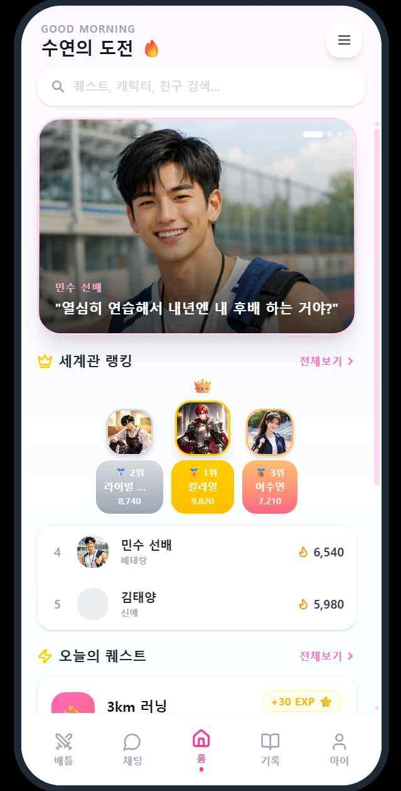
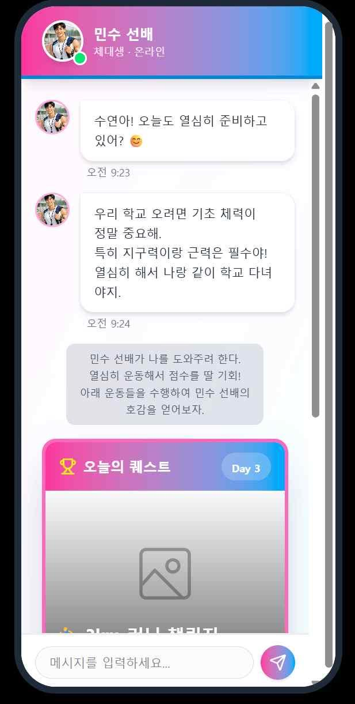
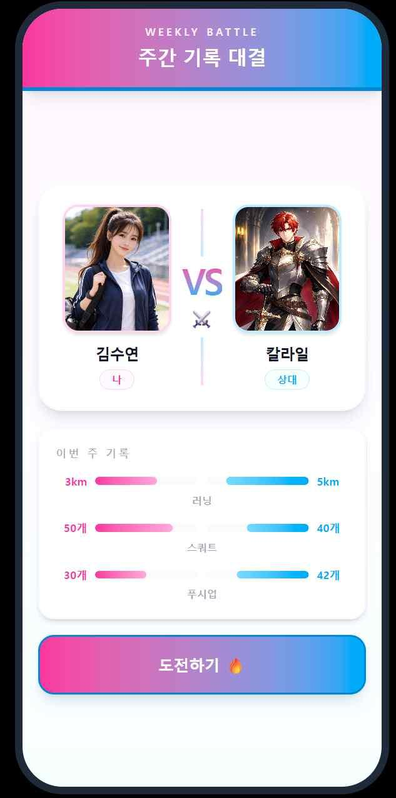
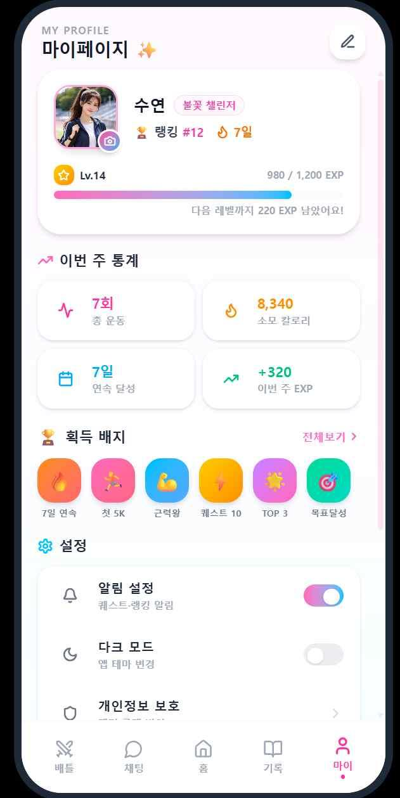
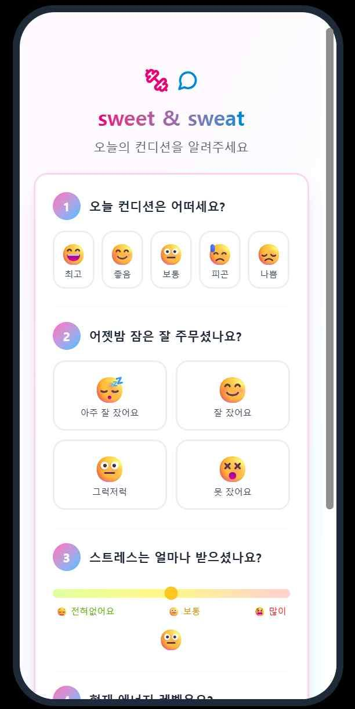
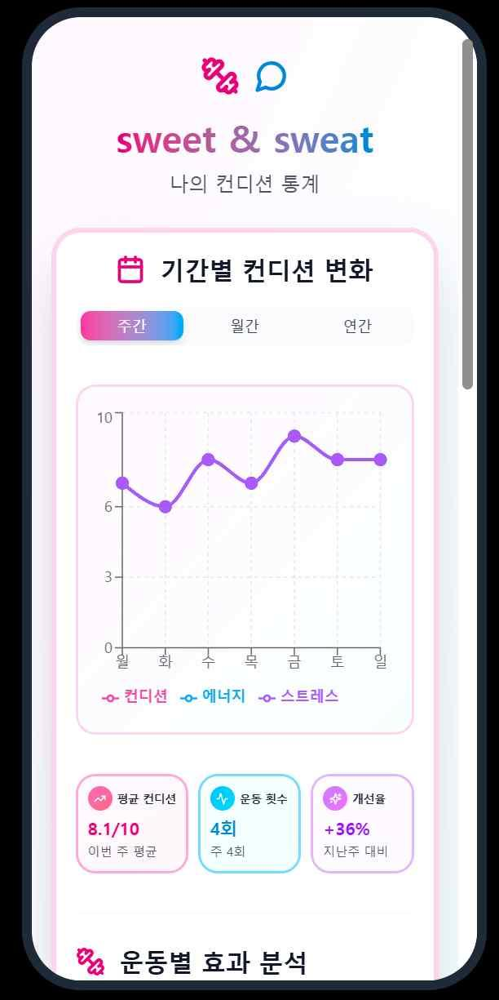
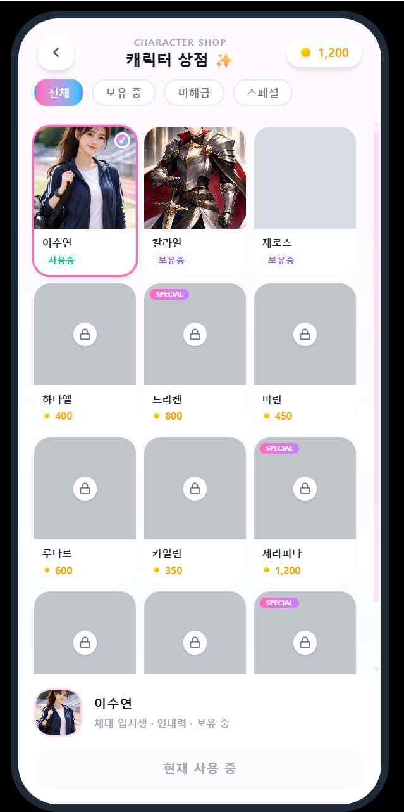

# Sweet & Sweat \| 캐릭터챗 기반 운동 습관 형성 앱
운동 습관 형성이 필요한 초보자가 캐릭터와 대화하며 스토리 속 퀘스트를 실제 운동으로 수행하고 보상을 얻는 모바일 앱.
- 담당: React Native 모바일 화면 구현 · 건강 데이터·알림 연동 · 앱·API 테스트
- 대표 문제 해결: 배틀 조회 전 건강 데이터 동기화 시점 조정, 대화 재진입 시 캐릭터 이미지 복원
- 핵심 흐름: 루틴 설정 → 오늘의 운동 확인 → 캐릭터 대화·운동 퀘스트 → 수행 완료·보상 → 스토리 진행


## 프로젝트 개요

| 항목 | 내용 |
| --- | --- |
| 개발 기간 | 2026.03.04 \~ 2026.06.10, 3개월 |
| 개발 형태·인원 | 대학 수업 팀 프로젝트, 3명 |
| 담당 직무 | 모바일 앱 개발 및 웨어러블 기기 연동 테스트 |
| 담당 범위 | 프로젝트 기획 및 UI 구성, React Native 기반 화면 구현, Health Connect 건강 데이터·FCM·알림 연동, 사용자 경험 테스트 |
| 모바일 기술 | React Native 0.85.2, React 19.2.3, TypeScript, React Navigation, Axios, Health Connect, Firebase Messaging, Notifee |
| 전체 시스템 | React Native 앱, Spring Boot 백엔드, FastAPI AI 서버로 구성. PostgreSQL·Redis·Docker·Tailscale 등을 팀의 서버 환경에 활용함 |
| 협업 도구 | Git·GitHub, Notion, Figma, Swagger |
| 저장소 | [sweetnsweat/mobile](https://github.com/sweetnsweat/mobile) |
| 배포·사용 현황 | 배포 이력 있음, 현재 운영은 중단된 상태 |

## 1. 문제 정의와 서비스 설계

# 운동 계획을 오늘의 행동으로 연결
운동 습관 형성이 필요한 초보자가 운동 정보를 확인한 뒤에도 오늘 무엇을 수행할지 결정하고 꾸준히 실천하는 데 어려움이 있을 수 있다는 문제 가설에서 출발함. 운동 계획을 작은 퀘스트로 나누고 캐릭터 대화·스토리·보상과 연결하여 다음 행동을 안내하고 반복 참여를 유도하고자 함.
- 기획 제안: 캐릭터·세계관·대화형 AI 프로젝트를 제안하고 운동 수행과 결합함.
- 요구사항 구체화: 팀 회의, Planfit의 추천·운동 상세·루틴 화면 벤치마킹, 중간 발표 피드백을 바탕으로 사용자 흐름을 정리함.
- 역할 구분: 루틴은 주간 운동 계획, 퀘스트는 오늘 수행할 실행 단위로 정의함. 건강 데이터는 운동 수행 검증을 돕는 보조 수단으로 활용함.
<details>
<summary>초기 조사: 건강 데이터와 운동 장소 정보의 연결</summary>

초기에는 건강 데이터 확인·운동 선택·장소 탐색이 분리되는 불편에 주목하여 건강 상태·컨디션·위치에 따른 운동·공공시설 추천을 검토함. 아래 비교는 초기 기획의 조사 관점이며, 최종 서비스의 구현 범위는 캐릭터챗과 운동 수행 흐름에 집중함.
- 삼성 헬스 / 애플 헬스: 건강 데이터 수집·기록·추세 분석을 비교 대상으로 검토함.
- Nike Run Club: 러닝 기록·코칭·챌린지를 통한 운동 참여 방식을 검토함.
- Strava: GPS 운동 기록·기록 비교·소셜 기능을 통한 참여 방식을 검토함.

</details>

### 초기 구상과 최종 범위의 차이

| 단계 | 검토한 내용 | 변경 이유와 결정 |
| --- | --- | --- |
| 초기 구상 | 건강 데이터 기반 상태 분석, 날씨와 공공시설 정보를 활용한 운동·장소 추천 | 건강 데이터만으로 세부 운동을 추천하는 데 한계가 있으며, 운동 추천의 의학적 근거와 검증 부담이 크다고 판단함 |
| 1차 방향 조정 | 처방보다 운동 수행을 유도하는 루틴·퀘스트에 집중함 | 루틴은 주간 계획, 퀘스트는 오늘 수행할 실행 단위로 역할을 나눔. 웨어러블 데이터는 수행 검증과 난이도 조절의 보조 수단으로 활용하기로 함 |
| 서비스 구체화 | 캐릭터 챗, 퀘스트, 보상, 캐릭터 성장, 경쟁을 핵심 구조로 정리 | 루틴 설정부터 운동 수행·보상·스토리 진행까지 이어지는 참여 흐름을 정의 |
| 중간 발표 이후 | 스토리·보상의 연결을 더 명확히 하거나 추가 기능을 제공하여 사용자의 몰입을 이끌어내야 한다는 피드백 수집 | 로그인 → 루틴 활성화 → 컨디션 입력 → 오늘의 루틴 조회 → 퀘스트 완료 → 보상 지급 → 스토리 진행 순서로 사용자 시나리오를 정리. 배틀·랭킹 기능을 추가하여 비슷한 기록의 상대와 경쟁, 향상심을 이용한 동기부여를 유도함. |

- **최종 구현:** 루틴 선택·생성, 컨디션 입력, 오늘의 운동 확인, 캐릭터 대화·퀘스트 수행, 보상·상점·랭킹·배틀을 연결함.
- **초기 검토 범위:** 장소 추천과 GPS·사진 인증 구상은 최종 구현 기능과 구분함.
- **본인 UI 판단:** 홈에서 오늘의 운동을 확인한 뒤 캐릭터·보상·랭킹으로 이동할 때 다음 행동을 이해할 수 있도록 구성함.

## 2. 핵심 문제 해결

### 2-1. 배틀 조회 시 최신 운동 기록이 반영되도록 동기화 시점 조정

#### 2-1-1. 문제 정의 및 원인 파악
- **기능 배경:** 건강 데이터와 퀘스트 수행량을 기준으로 배틀 기록을 비교함.
- **문제 상황:** 운동 후 최신 기록이 서버에 전달되지 않으면 앱의 점수와 실제 수행 기록 사이에 차이가 생길 수 있음.
- **기존 처리:** 매칭·상세 조회에서 `syncHealthDataWithServerIfStale()`을 호출함.
- **원인:** 마지막 동기화 후 기본 30분 이내에는 재동기화를 생략하는 구조였음.
- **코드 확인 결과:** 해당 간격 안에 생성된 운동 기록은 배틀 조회 전에 다시 전송되지 않을 수 있음을 확인함.

#### 2-1-2. 해결 과정
- **동기화 정책:** 일반 호출은 마지막 동기화 후 30분 이내 재호출을 생략하고, 매칭·결과 조회에서는 `force: true`로 시간 제한을 우회함. 일반 호출의 반복 전송 제한과 배틀 조회의 최신성 요구를 구분함.
- **중복 요청 제어:** `healthDataSyncInFlight`의 진행 중인 Promise를 공유하여 동시 호출이 같은 작업을 기다리도록 구성함. 강제 호출도 진행 중인 작업은 재사용함.
- **상세 재조회:** 서버의 `healthSync.recommended`에 따라 동기화 후 상세 정보를 한 번 더 조회하고 반환함. 같은 함수 안에서 무한 재조회하지 않음.

| 처리 시점 | 변경 내용 |
| --- | --- |
| 매칭 요청 전 | `syncHealthDataWithServer({ force: true })` 호출 후 매칭을 요청하도록 변경함 |
| 상세 조회 | 서버 응답의 `healthSync.recommended`가 참이면 강제 동기화 후 배틀 정보를 다시 조회하도록 변경함 |
| 결과 조회 전 | 강제 동기화 후 결과 API를 호출하도록 변경함 |
| 기록 표시 | 본인과 상대의 최근 건강 데이터 반영 시각을 표시하고, 시각 정보가 없으면 기록 반영 대기 상태를 표시함 |

#### 2-1-3. 결과
- **매칭·결과 조회:** 조회 전에 최신 기록을 전송하는 경로를 추가함.
- **상세 조회:** 서버가 동기화를 권장하면 기록 전송 후 배틀 정보를 재조회하도록 구현함.
- **화면 표시:** 사용자가 기록 반영 시각을 확인할 수 있도록 표시를 추가함.
- **한계:** 동기화 실패 시 로그를 남기고 배틀 조회를 계속함. 기본적으로 최근 30일 데이터를 읽어 전송하며, Health Connect에 아직 도착하지 않은 기기 기록은 반영할 수 없음. 따라서 모든 환경에서 최신 기록을 보장하지 않음.
- **근거:** [배틀 건강 데이터 반영 시점 수정 커밋](https://github.com/sweetnsweat/mobile/commit/6125ab045521b9ba833c7d837b9f6609015619e1), [건강 데이터 동기화 서비스](https://github.com/sweetnsweat/mobile/blob/375cbfe/src/services/HealthConnectService.ts)를 참고

### 2-2. 대화 기록을 다시 열었을 때 캐릭터 이미지가 누락되는 문제

#### 2-2-1. 문제 정의 및 원인 파악
- **기능 배경:** 이전 대화 기록을 다시 열어 캐릭터 스토리를 이어감.
- **문제 상황:** 텍스트 복원 후에도 캐릭터 이미지가 표시되지 않아 신규 대화와 재진입 화면의 경험이 달라짐.
- **기록 복원 원인:** 대화 기록을 화면 메시지로 변환할 때 이미지 정보를 복원하지 않는 구조였음.
- **컴포넌트 원인:** 이미지 로딩 실패 상태가 유지되어 URL이 바뀌어도 다시 로딩하지 않는 구조였음.

#### 2-2-2. 해결 과정
- **원인별 수정:** 메시지 변환 과정의 이미지 정보 누락과 공통 컴포넌트의 오류 상태 유지를 서로 다른 원인으로 구분하여 함께 수정함. 데이터 복원과 URL 변경 후 재로딩을 각각 처리함.
- **이미지 필드 복원:** `character_image_url`, `image_url`, `imageUrl`을 확인해 복원 메시지에 포함함.
- **경로 처리:** 상대 경로를 이미지 서버 주소와 결합하고 캐릭터 이름·이미지를 복원함.
- **누락 정보 보완:** 채팅방 조회 API에서 대표 캐릭터 또는 첫 캐릭터의 이미지·이름·소개를 가져와 빈 항목을 채움.
- **실패 상태 초기화:** `ImageWithFallback`의 URL 변경 시 오류 상태를 초기화함.

#### 2-2-3. 결과
- **기록 복원:** 메시지의 이미지 정보를 유지하고 부족한 캐릭터 정보를 별도 조회로 보완함.
- **이미지 재로딩:** URL 변경 시 이전 실패 상태를 초기화해 다시 표시할 수 있도록 수정함.
- **근거:** [히스토리 조회 시 캐릭터 이미지 오류 수정 커밋](https://github.com/sweetnsweat/mobile/commit/e65288a957b7cc59a3c7824604ddee0f29810441)을 참고

### 2-3. 추가 개선: 스토리 퀘스트 응답과 화면 상태 연결

#### 2-3-1. 문제 정의 및 원인 파악
- **사용자 요구:** 운동 퀘스트의 종목·목표와 스토리상 수행 이유를 확인해야 함.
- **문제 상황:** 응답과 다른 필드를 참조하면 제목이 기본 문구로 표시되거나 운동 목표가 누락될 수 있음.
- **기존 참조 필드:** `title`, `description`, `targetValue`, `targetMetric` 등을 사용함.
- **수정 내용:** 퀘스트 응답의 `quest_name`, `mission_text`, `exercise_name`, `target`, `story_reason`에 맞춰 화면 표시를 수정함.

#### 2-3-2. 해결 과정
- **데이터 매핑:** 스토리 퀘스트 응답에 맞춰 화면의 참조 필드와 표시 항목을 변경함.

| 화면 항목 | 적용한 응답 필드 |
| --- | --- |
| 퀘스트 제목 | `quest_name`을 표시함 |
| 미션 안내 | `mission_text`를 표시함 |
| 운동 종목 | `exercise_name`을 표시함 |
| 수행 목표 | `target`을 표시함 |
| 스토리와의 연결 이유 | `story_reason`을 표시함 |

- **퀘스트 상태 처리:** 운동 퀘스트 ID가 전달되면 기존 대화 선택지를 비우고 활성 퀘스트를 설정함.
- **화면 상태 구분:** 운동 수행 단계와 일반 대화 선택 단계를 구분함.

#### 2-3-3. 결과
- **표시 결과:** 퀘스트 제목·운동·목표·수행 이유를 응답 필드에 맞춰 표시함.
- **사용자 흐름:** 스토리에서 제시된 운동과 다음 수행 목표를 함께 확인할 수 있도록 변경함.
- **근거:** [스토리 퀘스트 표시 및 상태 처리 변경 커밋](https://github.com/sweetnsweat/mobile/commit/4e9475780924d3ce5ee4a8b1fb33622b43a75760)

### 2-4. 알림 진입과 내비게이션 초기화 시점 연결
- 처리 조건: 알림 클릭에 따른 화면 이동 요청이 내비게이션 초기화보다 먼저 발생하는 경우를 처리함.
- 구현: `runWhenNavigationReady()`에서 준비 여부를 확인하고, 준비 전이면 이동 작업을 보관함. `NavigationContainer`의 `onReady`에서 보관한 작업을 실행함.
- 적용: 앱 최초 실행 알림·백그라운드 알림 클릭을 배틀·결과·통계 화면 이동으로 연결함.
- 한계: 보류 작업은 하나만 저장함. 내비게이션 준비와 로그인 완료는 별도 조건이며, 현재 코드에서는 이 두 조건을 함께 보장하지 않음.
- 검증 범위: 코드에서 확인되는 처리 구조이며, 상태별 실기기 통과 기록은 별도로 첨부하지 않음.
- 근거: [화면 이동 서비스](https://github.com/sweetnsweat/mobile/blob/375cbfeeabda70e1e3caeed58949e9dbefdaa7de/src/navigation/NavigationService.ts), [알림 서비스](https://github.com/sweetnsweat/mobile/blob/375cbfeeabda70e1e3caeed58949e9dbefdaa7de/src/services/FcmService.ts)

## 3. 기술 적용과 담당 범위

### 화면·서비스·내비게이션의 책임 구분
- 화면: 입력·로딩·대화·활성 퀘스트 등 UI 상태를 `useState`·`useRef`로 관리함.
- 도메인 서비스: 스토리·인증·배틀 등 API 요청과 응답 타입, 데이터 처리 함수를 관리함.
- 내비게이션: `RootStackParamList`로 경로와 매개변수 타입을 정의하고, 화면 밖 알림 이벤트의 이동 요청을 별도 서비스에서 처리함.
- 공통 컴포넌트: 이미지 대체 표시·배경·알림창 등 반복 요소를 공유함.
- 구조적 한계: 캐릭터 퀘스트 화면에 기록 복원·응답 적용·챕터 이동·운동 완료·스크롤 처리가 모여 있어 상태 전이와 데이터 변환을 더 분리할 여지가 있음.

### 건강 데이터의 서버 전송 형식 정규화
- 운동 세션의 시작·종료 시각에서 분 단위 수행 시간을 계산하고, 걸음 수·거리·칼로리를 공통 샘플 구조로 변환함.
- 거리는 퀘스트 검증에서 km, 서버 동기화에서는 m로 변환하여 각 요청 형식에 맞춤.
- 권한 허용·거부 결과를 구분하고, 기록 유형별 읽기 오류를 개별 결과로 반환함.
- 근거: [건강 데이터 변환·동기화 코드](https://github.com/sweetnsweat/mobile/blob/375cbfeeabda70e1e3caeed58949e9dbefdaa7de/src/services/HealthConnectService.ts)

| 기술 | 적용 내용과 역할 |
| --- | --- |
| React Native·TypeScript | 앱의 모든 화면과 사용자 인터랙션을 구현하고, 서비스·화면·API 응답 타입을 관리함 |
| React Navigation | 인증·온보딩·컨디션 입력과 홈·루틴·대화·배틀·마이페이지 사이의 화면 전환을 구성함 |
| Axios | 인증·루틴·퀘스트·상점·배틀 등 도메인별 서비스 모듈로 API 호출을 분리함 |
| Health Connect | 걸음 수·거리·칼로리·운동 세션 등의 기록을 조회하고 서버 전송용 샘플로 변환함. 팀의 방향 조정에 따라 건강 데이터를 운동 처방보다 수행 검증에 활용함 |
| Firebase Messaging·Notifee | 로그인 후 FCM 토큰 등록, 알림 권한 요청, 토큰 갱신, 알림 수신·표시·클릭 처리를 연동함 |
| Figma | 모바일 UI 구성과 협업에 활용함 |
| Spring Boot·PostgreSQL·Redis | 백엔드 담당자가 인증, 루틴, 퀘스트 완료, 보상, 상점, 배틀과 데이터 저장을 구현함. 본인은 모바일에서 해당 API를 연결하고 테스트함 |
| FastAPI·LangChain·LangGraph·OpenAI API | AI 담당자가 캐릭터 스토리·대화·선택지·퀘스트 생성과 진행 상태를 구현함. 본인은 앱의 대화·퀘스트 표시와 기록 복원 흐름을 구현함 |

## 4. 검증
- **본인 담당:** 모바일 기능·API 연동 테스트를 전담함.
- **검증 과정:** 주요 기능 반복 확인 → 오류 원인 정리·팀원 공유 → 수정 후 재검증을 수행함.
- **확인 범위:** 화면 동작, API 상태 코드·응답값·오류 메시지를 함께 확인함.

| 검증 항목 | 방법 | 확인한 내용·근거 |
| --- | --- | --- |
| 주요 기능과 화면 흐름 | 회원가입·로그인·퀘스트 조회·캐릭터 선택·랭킹 조회·상점 이용을 반복 테스트함 | 화면 이동·버튼 동작·입력값 처리를 점검하고, 오류를 팀원과 공유한 뒤 수정 후 재검증함 |
| 앱·서버 API 연동 | React Native 앱과 Spring Boot 서버의 요청·응답을 확인함 | 상태 코드·응답값·오류 메시지를 확인하고 연동 오류를 팀원에게 공유함 |
| 건강 데이터 연동 | Android 실기기와 웨어러블 연동 환경에서 테스트함 | 권한 설정·데이터 수집·연결 문제를 확인함. [읽기 권한 선언](https://github.com/sweetnsweat/mobile/commit/504a09f2f8b10821e78455e01f56a1c05db2bed3)과 [Android 권한 처리 연결](https://github.com/sweetnsweat/mobile/commit/3b30a915ad95a0ee67f476437de9235f071d9298)을 코드 근거로 확인할 수 있음 |
| 오류 수정 전후 | 수정 커밋의 변경 전후 코드를 확인함 | 배틀 동기화 시점, 이미지 복원, 퀘스트 필드 매핑의 변경 근거를 확인할 수 있음. 당시 오류별 재현·통과 기록은 별도로 첨부되어 있지 않음 |
| 최종 발표 준비 | 로그인 후 루틴·퀘스트 조회, 스토리 진행, 퀘스트 완료·보상 확인 순서로 시연을 준비함 | 5월 27일 회의에서 화면 전환과 데이터 표시, API 동작 점검 범위를 정리함 |

- **추가 수정:** [세계관 상세 모달 스크롤 수정](https://github.com/sweetnsweat/mobile/commit/cbe5e48a27e9a87431677c976763ea9be12d9de9), [Firebase Messaging 호출 방식 변경](https://github.com/sweetnsweat/mobile/commit/6801f2905feaee52d730422883a1dba248ce864a) 내역이 있음.
- **자동 테스트 코드:** 앱 렌더링을 확인하는 [기본 테스트](https://github.com/sweetnsweat/mobile/blob/375cbfe/__tests__/App.test.tsx)가 있음.
- **미확인 결과:** 자동 테스트 통과 이력, 오류별 회귀 테스트, iOS 실기기 검증 결과는 자료에 포함되어 있지 않음.
- **성능 목표:** 응답 시간 3초 이내·동시 사용자 100명은 요구명세서의 검수 목표이며, 측정 결과가 없어 달성 성과로 기재하지 않음.
- \[첨부 필요: 오류별 재현 절차 및 수정 후 확인 기록\]
<details>
<summary>향후 보강할 검증·설계 과제 — 미구현·미검증</summary>

- 동기화 회귀 테스트: 30분 이내 생략·강제 호출·동시 요청 공유·실패 후 재시도 조건을 검증할 필요가 있음.
- 건강 데이터 페이지네이션: 반환된 `pageToken`으로 후속 페이지를 읽고, 1,000건을 넘는 기록의 누락 여부를 검증할 필요가 있음.
- 계정 전환: 전역 동기화 시각·진행 중 요청의 계정 간 영향을 재현하고 사용자별 분리 또는 초기화 정책을 적용할 필요가 있음.
- 빈 기록 처리: 실제 기록 없음과 권한 거부·읽기 실패를 구분하여 마지막 동기화 시각 갱신 정책을 점검할 필요가 있음.
- 스토리 상태 분리: 응답 정규화와 대화·선택·운동 수행·완료 상태 전이를 분리해 테스트할 필요가 있음.
- 알림 진입 검증: 앱 종료·백그라운드·로그아웃 상태별 진입을 검증하고 인증 완료 후 이동 정책을 보강할 필요가 있음.

</details>

## 5. 구현 결과와 피드백 반영
앱·백엔드·AI 서버를 연결하여 루틴 설정부터 캐릭터 대화·운동 퀘스트·보상까지 이어지는 사용자 흐름을 구현함. 본인은 모바일 화면과 건강 데이터·알림 연동, 앱·API 테스트를 담당함.

### 사용자에게 제공한 기능
아래는 구현 범위이며, 운동 지속률·참여도 향상은 별도로 측정하지 않음.

| 추가·개선한 기능 | 사용자가 수행할 수 있게 된 활동 |
| --- | --- |
| 온보딩·루틴·컨디션 입력 | 운동 경험과 선호 운동을 입력하고, 기본 루틴 선택 또는 직접 생성한 루틴을 오늘 수행할 운동과 연결함 |
| 캐릭터 대화와 운동 퀘스트 | 스토리를 진행하면서 운동 종목·목표·수행 이유를 확인하고 퀘스트를 수행함 |
| 건강 데이터 연동 | 기기에 기록된 운동 데이터를 앱에서 읽어 퀘스트·배틀 검증에 활용하는 흐름을 제공함 |
| 보상·상점·마이페이지 | 수행 후 보상과 성장 정보를 확인하고, 재화를 사용하거나 보유 요소를 조회함 |
| 배틀·랭킹 | 다른 사용자와 기록을 비교하고 결과를 확인함. 배틀 화면에 기록 반영 시각을 표시함 |
| 대화 기록 복원 | 기존 대화와 캐릭터 정보를 복원해 스토리를 이어갈 수 있도록 함 |
| 푸시 알림 | 사용자가 알림 권한과 수신 설정을 조절하고, 알림을 통해 관련 화면으로 진입하는 흐름을 제공함 |

- **팀 전체 결과:** 앱·백엔드·AI 서버를 연결한 서비스를 구현함.
- **본인 기여:** 모든 모바일 화면, 건강 데이터·알림 연동, 앱 기능·API 테스트를 담당함.
- **공동 작업 범위:** 상점 API 연결 등 모바일 저장소에도 팀원의 기여가 포함됨.

### 중간 발표 피드백 반영
- **받은 의견:** 루틴·퀘스트·캐릭터 스토리·보상 사이의 연결을 더 명확히 해야 한다는 피드백을 받음.
- **팀의 반영:** 사용자 시나리오를 고정하고 퀘스트 완료 직후 경험치·배지를 지급하는 흐름을 우선 구현하기로 함.
- **본인 작업:** 해당 흐름의 화면 연결과 데이터 표시를 점검함.

### 주요 화면
- **자료 출처:** 최종 결과보고서의 사용자 매뉴얼에 수록된 UI 자료를 사용함.

| 캐릭터 대화·퀘스트 | 배틀 | 마이페이지 |
| --- | --- | --- |
|  |  |  |

| 컨디션 입력 | 통계 조회 | 캐릭터 상점 |
| --- | --- | --- |
|  |  |  |


## 6. 실행 환경
서버 운영은 현재 중단된 상태이며, 당시와 동일한 서비스 사용 환경을 제공하지 않음.
<details>
<summary>Android 실행·빌드 설정</summary>

### 실행 환경과 필수 설정

| 항목 | 확인된 설정 |
| --- | --- |
| Node.js | `package.json`에서 22.11.0 이상을 요구함 |
| Android | Android Studio 기반 개발 환경을 사용함. Gradle 설정은 최소 SDK 26, 컴파일·대상 SDK 36임 |
| 건강 데이터 | Health Connect 지원 환경과 읽기 권한이 필요함. 실제 건강 데이터 연동 검증은 Android 실기기 기준으로 수행함 |
| API 연결 | `src/config/api.ts`에서 백엔드 API와 AI 이미지 서버 주소를 설정함. Tailscale 기반 개발 서버를 공유했으며 현재 운영은 중단됨 |
| 알림 | Android Firebase 설정과 서버의 발송 설정이 필요함. Android 13 이상 알림 권한 요청을 코드에 포함함 |

### 저장소 문서에 명시된 Android 실행 명령
- **명령어 근거:** [Android FCM 연동 가이드](https://github.com/sweetnsweat/mobile/blob/375cbfe/docs/FCM_ANDROID_FRONTEND_GUIDE.md)에 Firebase 패키지 설치 후 Android 빌드 실행 명령이 명시됨.

```bash
npm run android

```

- **스크립트 연결:** `package.json`의 `react-native run-android`를 실행함.
※ 서버 운영 중단으로 당시와 동일한 서비스 사용 환경을 제공하지 않음.

</details>

## 관련 문서

| 자료 | 확인할 수 있는 내용 |
| --- | --- |
| 요구명세서 \[첨부 필요: 저장소 내 문서 링크\] | 기능 요구사항, UI 요구사항, 비기능 요구사항과 검수 목표를 확인할 수 있음 |
| 최종 결과보고서 \[첨부 필요: 저장소 내 문서 링크\] | 시스템 구조, 구현 기술, 주요 함수, 사용자 매뉴얼, 역할 분담, 회의록과 팀원별 포트폴리오를 확인할 수 있음 |
| 본인 최종보고서 \[첨부 필요: 저장소 내 문서 링크\] | 모바일 화면 구현, 건강 데이터 연동, 앱·API 테스트 기여를 확인할 수 있음 |
| [Android FCM 연동 가이드](https://github.com/sweetnsweat/mobile/blob/375cbfe/docs/FCM_ANDROID_FRONTEND_GUIDE.md) | 모바일·백엔드·서버의 알림 연동 역할과 설정을 확인할 수 있음 |
